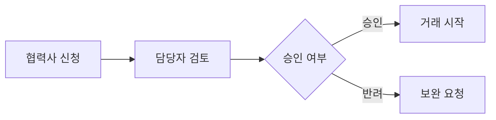

# 한글 IME 조합 혼합 검증 문서

이 파일은 검증용 복사본에서 편집합니다. 원본 fixture를 덮어쓰지 않습니다.

## 1. 기본 조합

아래 빈 줄의 커서에서 한국어 IME 두벌식으로 입력하세요.
확정형 문자열 붙여넣기가 아니라 실제 키 입력으로 `ㅎ → 하 → 한`을 관찰합니다.


검증 문장: 한글 입력 테스트 / GS리테일 협력사 포털 / ABC한글123 / 가나다라마 / 값이 / 읽고 / 앉아

## 2. 선택 대체와 혼합 문자열

앞부분 기존선택영역 뒷부분

영문 ABC, 한글 가나다, 숫자 123, 이모지 😀, 기호 ()[]{} 및 **굵은 글씨**, *기울임*, `inline code`.

- 협력사 등록
- 상품 입점 신청
  - 편의점
  - 수퍼

> 한글 조합 중 취소·저장·탭 전환·다중 커서 후에도 앞뒤 내용이 보존되어야 합니다.

## 3. 줄바꿈과 커서

창을 좁게 하고 자동 줄바꿈을 켭니다. 이 문장의 중간과 시각적 줄 끝에서 한글을 입력하면서 커서와 조합 글자가 같은 행에 표시되는지 확인합니다. 조합 중 뒤쪽 문자가 겹치거나 다음 행이 사라지면 실패입니다. 협력사 상품 등록 검토 승인 반려 재신청 처리 결과 안내 문장으로 긴 줄을 유지합니다.

자동 줄바꿈을 끈 상태에서는 긴 줄의 끝으로 이동하여 가로 스크롤 뒤 입력을 확인합니다.

## 4. 표

| 업무 | 상태 | 비고 |
|---|---|---|
| 신규 협력사 등록 | 검토 중 | 한글 입력 |
| 상품 제안 | 승인 대기 | ABC한글123 |
| 변경 요청 | 재검토 | 😀 이모지 포함 |

## 5. 코드와 다이어그램

```json
{
  "partner": "협력사",
  "status": "검토 중",
  "channel": "편의점/수퍼"
}
```



## 6. 다중 커서

아래 세 줄의 `|` 앞에 Alt+클릭으로 커서를 추가한 뒤 한글을 입력합니다.
조합이 시작되면 보조 커서는 사라지고, 기본 커서 한 곳에만 글자가 들어가야 합니다.
Ctrl+Z 한 번으로 그 입력만 취소되어야 합니다.

- 첫째 |
- 둘째 |
- 셋째 |

[첫 섹션으로 이동](#1-기본-조합)
